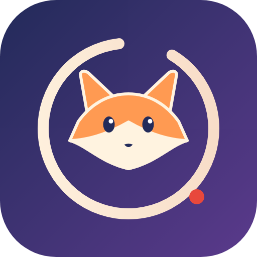
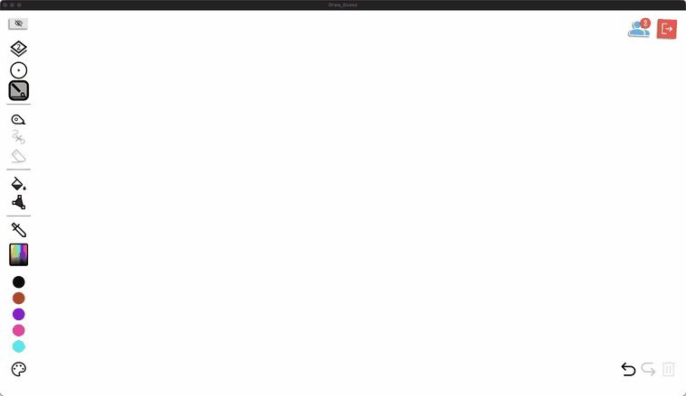
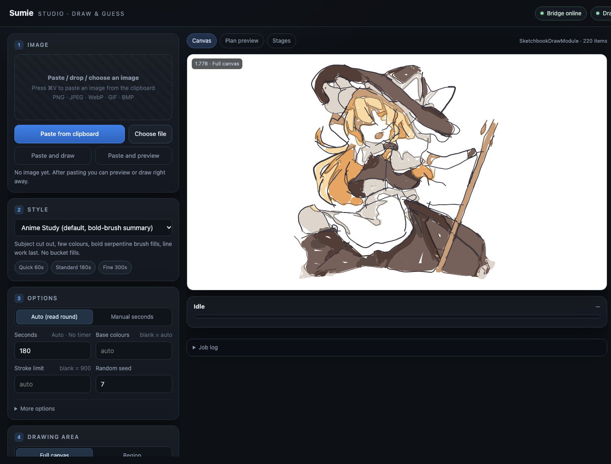

<div align="center">



# Sumie · 墨绘

**Zeichnet eine Illustration Strich für Strich in *Draw & Guess* – so, wie es ein Mensch tun würde.**

[](https://github.com/ClarkeLi/sumie/actions/workflows/tests.yml)
[](LICENSE)


[简体中文](README.md) · [English](README.en.md) · [日本語](README.ja.md) · [한국어](README.ko.md) · **Deutsch**

<br>



<sub>Demo: Stil <code>anime_human</code>, 300 s Budget, Farbflächen-Grenzen aus (<code>--borders off</code>), beschleunigt. Volle Qualität: <a href="assets/demo.mp4">assets/demo.mp4</a></sub>

</div>

---

Sumie ist ein [BepInEx](https://github.com/BepInEx/BepInEx)-Plugin für das Steam-Spiel **Draw & Guess** samt lokaler Web-Oberfläche. Bild in die Seite einfügen, Plan in der Vorschau prüfen, auf „Zeichnen starten“ klicken: Sumie plant Linien, Farbflächen, Schatten und Details und zeichnet sie dann Strich für Strich **wie ein Spieler mit Grafiktablett** – fertig innerhalb des Zeitlimits der Runde.

> ## ⚠️ Wichtiger Hinweis und Nutzungsbeschränkungen
>
> 1. **Nur zum Lernen und für den fachlichen Austausch.** Das Projekt dient dazu, Plugin-Mechanismen von Spielen, Bildverarbeitung und Mensch-Computer-Interaktion zu untersuchen. **Kommerzielle Nutzung ist untersagt**, ebenso jede Nutzung, die gegen Gesetze oder die Nutzungsbedingungen des Spiels verstößt.
> 2. **Nicht in Online-Mehrspielerpartien verwenden.** Der Einsatz in öffentlichen Räumen, Matchmaking, Ranglisten- oder Turnierpartien ist untersagt, weil er das Erlebnis und die Fairness anderer Spieler beeinträchtigt. Nur im Solo-Skizzenbuch oder in einem privaten Rahmen, in dem **alle Beteiligten ausdrücklich zustimmen**.
> 3. **Innerhalb von 24 Stunden nach dem Download löschen.** Code, Dokumente und Beispiele dienen nur zum Lesen und Lernen; nach dem Ausprobieren oder Studieren bitte umgehend löschen, nicht weiterverbreiten und nicht anderweitig verwenden.
> 4. **Nutzung auf eigenes Risiko.** Die Nutzung kann gegen die Nutzungsbedingungen des Spiels verstoßen und zu Einschränkungen oder Sperrung deines Kontos führen; alle Folgen trägst du selbst. Das Projekt wird „wie besehen“ ohne jede Gewähr bereitgestellt, der Autor haftet nicht für Schäden.
> 5. **Inoffiziell.** Keine Verbindung zu den Entwicklern des Spiels; *Draw & Guess* sowie zugehörige Marken, Grafiken und Programme gehören ihren jeweiligen Inhabern. Das Projekt verteilt keine Spieldateien.
> 6. **Urheberrecht.** Die Illustration in der Demo gehört ihrem ursprünglichen Urheber und wird nur zur Demonstration des Ergebnisses gezeigt; bei Rechtsverletzung bitte melden, sie wird sofort entfernt.
>
> Mit dem Download, der Installation oder der Nutzung bestätigst du, dass du das Obige gelesen hast und ihm zustimmst.

> Inoffizielles Fan-Projekt, nicht mit den Entwicklern des Spiels verbunden. Bitte zuerst den Abschnitt „Fair Play“ weiter unten lesen.

## ✨ Funktionen

- **Keine Mausemulation.** Die Striche gehen direkt an die eigenen Zeichenfunktionen des Spiels – keine Bedienungshilfen- oder Bildschirmaufnahme-Berechtigung nötig, und sie nutzen Rückgängig und Multiplayer-Synchronisation des Spiels.
- **`anime_human`: zeichnet wie ein Mensch.** Jeder Strich hat seine eigene Druckbreite (genau wie bei Tablet-Spielern), der Rhythmus stammt aus echten Kritzel-Statistiken (Google *Quick, Draw!*), erst die Linien, dann die Farbe. Farbe wird mit dem Pinsel auf **virtuellen Ebenen** unter den Linien aufgetragen (das Plugin teilt die 3 Sortierebenen des Spiels in 9; andere Spieler sehen sie ebenfalls). Wenn das nicht geht, greift der Farbeimer – geprüft an einem Offline-Modell der Füllregeln des Spiels.
- **Pünktlich.** Liest den Rundentimer, hält einen Sicherheitsabstand und komprimiert bei Bedarf das Tempo.
- **Web-Oberfläche** unter `http://127.0.0.1:8765/`: Bild einfügen / ablegen → Stil wählen → Vorschau mit Kennzahlen → Zeichnen → Rückgängig / Export / Wiederherstellen; aktuelles Wort und Countdown live.
- **Fünf Sprachen im UI:** 简体中文, English, 日本語, 한국어, Deutsch – folgt der Browsersprache, manuell umschaltbar.
- **Sechs Stile:** `anime_human` (empfohlen), `anime_study`, `anime_flat`, `sketch`, `impasto`, `watercolor`.
- **Installation in einem Schritt**, ein vollständiges technisches Whitepaper und eine HTTP/WebSocket-API.

## 🖥 Web-Oberfläche



Die Sprache lässt sich oben rechts umschalten.

## 🏗 Architektur


| Teil | Aufgabe |
|---|---|
| **Plugin** `DrawGuessBridge.dll` (im Spielprozess) | HTTP/WebSocket-Bridge auf `127.0.0.1:8765`; Main-Thread-Dispatch; macht aus Strichen Spielelemente; virtueller Stift und Ebenen; startet/stoppt den Python-Dienst |
| **Zeichendienst** `studio_server.py` (lokales Python, `:8770`) | Auftragswarteschlange, Wahrnehmung (Linien / Motivmaske / Palette), Planung, Menschmodell, Vorschau und Kennzahlen, Ausführung Strich für Strich |
| **Oberfläche** `ui.html` (vom Plugin ausgeliefert) | Bild, Stil, Parameter, Vorschau, Zeichnen, Rückgängig / Export / Wiederherstellen, Live-Spielstatus |

Geometrie und Ästhetik liegen in Python; C# schiebt Anfragen nur sicher auf den Unity-Main-Thread. Details im [technischen Whitepaper](docs/whitepaper.en.md) (Englisch / [Chinesisch](docs/whitepaper.zh-CN.md)).

## 📦 Installation

### Voraussetzungen

| System | Status | Hinweis |
|---|---|---|
| macOS · Apple Silicon (M1 und neuer) | ✅ | das Spiel ist ein x86_64-Programm und läuft über Rosetta 2; `install.sh` installiert Rosetta für dich |
| macOS · Intel | ✅ | `install.sh` |
| Windows 10 / 11 (x64) | ✅ | `install.ps1` |
| Linux x86_64 (Ubuntu / Debian / Fedora / Arch / SteamOS) | 🧪 experimentell | Steam bietet einen nativen Linux-Build und der Installer unterstützt ihn, er wurde aber noch nicht auf echter Hardware geprüft; Rückmeldungen willkommen |

Spiel: Draw & Guess auf Steam, **Mono-Build** (IL2CPP lehnt der Installer ab)

Python 3.10 oder neuer · .NET SDK 6 oder neuer · einige hundert MB Speicher (die optionale KI-Erweiterung braucht ~400 MB Modelle plus PyTorch).

Das Plugin wird auf deinem Rechner gegen die eigenen Assemblies des Spiels kompiliert; vom Spiel selbst wird nichts weitergegeben.

### Variante A: Ein-Schritt-Installer (empfohlen)

Voraussetzungen installieren – macOS ([Homebrew](https://brew.sh)):

```bash
brew install python git
brew install --cask dotnet-sdk
```

Windows (PowerShell):

```powershell
winget install Python.Python.3.12
winget install Microsoft.DotNet.SDK.8
winget install Git.Git
```

Linux (Beispiel Debian / Ubuntu):

```bash
sudo apt install python3 python3-venv git dotnet-sdk-8.0
```

Ein **neues Terminal** öffnen, `Sumie-v1.0.0.zip` von den [Releases](https://github.com/ClarkeLi/sumie/releases) laden und entpacken (oder `git clone https://github.com/ClarkeLi/sumie.git`), **das Spiel schließen** und ausführen:

```bash
# macOS (Intel / Apple Silicon) oder Linux
./install.sh            # mit --ai zusätzlich KI-Linien-/Segmentierungsmodelle (beste Qualität, ~400 MB)
```

```powershell
# Windows (PowerShell)
.\install.ps1           # mit -Ai dasselbe
```

Das Skript legt `.venv` im Ordner an und installiert die Abhängigkeiten → findet das Spiel über deine Steam-Bibliotheken → lädt BepInEx 6 und prüft es → baut das Plugin → kopiert es ins Spiel und schreibt die Konfiguration. Wird das Spiel nicht gefunden: `./install.sh --game "/path/to/steamapps/common/Draw & Guess"`. `--check` prüft nur, `--uninstall` entfernt das Plugin (BepInEx bleibt).

### Variante B: drei manuelle Schritte

```bash
git clone https://github.com/ClarkeLi/sumie.git && cd sumie
python3 tools/setup.py [--ai]     # Windows: python tools\setup.py
python3 tools/install.py          # Windows: python tools\install.py
```

Ohne KI-Modelle greift klassische Kantenerkennung mit GrabCut – es funktioniert, aber mit geringerer Qualität.

## ▶️ Benutzung

**macOS** braucht einmalig eine Steam-Startoption: Steam → Rechtsklick auf *Draw & Guess* → Eigenschaften → Startoptionen, dort die vom Installer zuletzt ausgegebene Zeile einfügen:

```text
"/…/Draw & Guess/beta/run_bepinex.sh" %command%
```

**Linux** funktioniert wie macOS: Die vom Installer ausgegebene Zeile (`"…/run_bepinex.sh" %command%`) in die Steam-Startoptionen einfügen. Die Linux-Unterstützung ist experimentell.

**Windows** braucht nichts – das Spiel wie gewohnt über Steam starten.

Dann:

1. Im Spiel **Hauptmenü → Skizzenbuch → neu** wählen oder einer Zeichenrunde beitreten;
2. im Browser **http://127.0.0.1:8765/** öffnen;
3. mit `⌘V` / `Strg+V` ein Bild einfügen oder eine Datei ablegen;
4. den Stil **Anime Human** wählen, mit **Vorschau erzeugen** den Plan prüfen und dann **Zeichnen starten**.

Rauchtest ohne Spiel:

```bash
python3 client/dg_artist.py examples/sample.png --style anime_human --time 120 --dry-run --preview .cache/preview.png
```

### Nützliche Kommandozeilen

```bash
python3 client/dg_artist.py bild.png --style anime_human --time 180                       # zeichnen
python3 client/dg_artist.py bild.png --style anime_human --region 0.1,0.1,0.5,0.8         # nur ein Bereich
python3 client/dg_artist.py bild.png --style anime_human --time 120 --dry-run --plan-out plan.json --preview plan.png
```

Alle Optionen: [docs/usage.md](docs/usage.md); API: [docs/api-reference.md](docs/api-reference.md) (derzeit auf Chinesisch).

## 🎨 Stile

| Stil | Charakter |
|---|---|
| `anime_human` ★ | wie ein Tablet-Spieler: Druckbreiten, menschlicher Rhythmus, erst Linien dann Farbe, virtuelle Ebenen |
| `anime_study` | Motiv freigestellt, wenige Farben, grobe Schlangenlinien, zuletzt Linien (keine Füllungen) |
| `anime_flat` | Farbflächen + Mittellinien, für flächige Illustrationen |
| `sketch` | Mittellinien, Schraffur und wenige Farbakzente |
| `impasto` | mehrlagige Kurvenstriche, pastoser Look |
| `watercolor` | helle Farbflächen, Weißraum und feine Linien |

## 🔄 Aktualisieren und deinstallieren

```bash
git pull && ./install.sh          # neu bauen und installieren (Windows: .\install.ps1)
./install.sh --uninstall          # Plugin entfernen, BepInEx behalten
```

Nach einem Spiel-Update den Installer erneut ausführen; ändern sich Interna des Spiels, muss das Plugin eventuell angepasst werden.

## 🩺 Fehlerbehebung

| Problem | Lösung |
|---|---|
| `could not find Draw & Guess` | Ordner mit `--game` angeben |
| `a .NET SDK is required` | installieren und ein **neues Terminal** öffnen |
| `uses IL2CPP` | dieser Spiel-Build wird nicht unterstützt; Mono-Build verwenden |
| Seite lädt nicht | das Plugin läuft nicht. macOS: Startoption prüfen. Windows: liegt `winhttp.dll` neben der Spiel-exe? Danach `BepInEx/LogOutput.log` im Spielordner lesen |
| Seite lädt, aber „Zeichendienst“ ist rot | Installer erneut ausführen (schreibt die `[Studio]`-Pfade neu); nach dem Verschieben des Ordners neu installieren |
| `canDraw: false` | du bist nicht auf einer Zeichenfläche oder nicht an der Reihe |

## 📚 Dokumentation

- [Technisches Whitepaper (Englisch)](docs/whitepaper.en.md) · [技术白皮书 (Chinesisch)](docs/whitepaper.zh-CN.md)
- [Doku-Index](docs/README.md): Architektur, API, Renderer, `anime_human`, Studio, Verifikation, Entwicklung (derzeit Chinesisch)

## ⚖️ Fair Play

Sumie ist gedacht für Solo-Skizzenbuch, private Lobbys mit einverstandenen Freunden, Experimente und zum Lernen. Nutze es nicht, um in öffentlichen Partien einen unfairen Vorteil zu erlangen oder andere Spieler zu stören; die Einhaltung der Nutzungsbedingungen des Spiels liegt bei dir. Dass Ergebnis und Ablauf wie von Hand gezeichnet wirken, dient der Optik – nicht dem Verschleiern der Identität oder dem Umgehen von Erkennung.

Webserver und Zeichendienst lauschen nur auf `127.0.0.1`; ist in der Plugin-Konfiguration ein `Token` gesetzt, müssen API-Anfragen es mitsenden. **Diese Ports nicht ins Netzwerk freigeben.**

## 🧪 Entwicklung

```bash
python3 -m unittest discover -s tests     # offline, ohne Spiel
python3 tools/make_release.py             # erzeugt releases/Sumie-v<Version>.zip
```

Siehe [docs/development.md](docs/development.md).

## 📄 Lizenz und Danksagung

[MIT](LICENSE). Komponenten und Modelle Dritter stehen in [NOTICE.md](NOTICE.md): Anime2Sketch (MIT), anime-segmentation (Apache-2.0), BepInEx (LGPL-2.1), Google *Quick, Draw!* (CC BY 4.0, nur zusammenfassende Statistiken). Das Logo ist original für dieses Projekt. Die in der Demo nachgezeichnete Illustration ist Fan-Kunst Dritter; das Urheberrecht liegt bei der Urheberin bzw. dem Urheber, sie dient nur zur Demonstration des Renderings – bei Einwänden der Rechteinhaber bitte melden, sie wird dann entfernt. `examples/fox.svg` ist ein eigenes Testbild.
