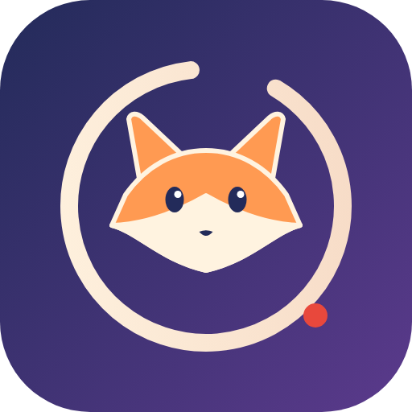
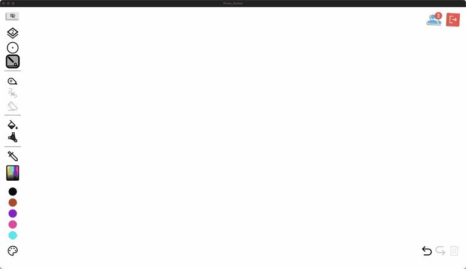
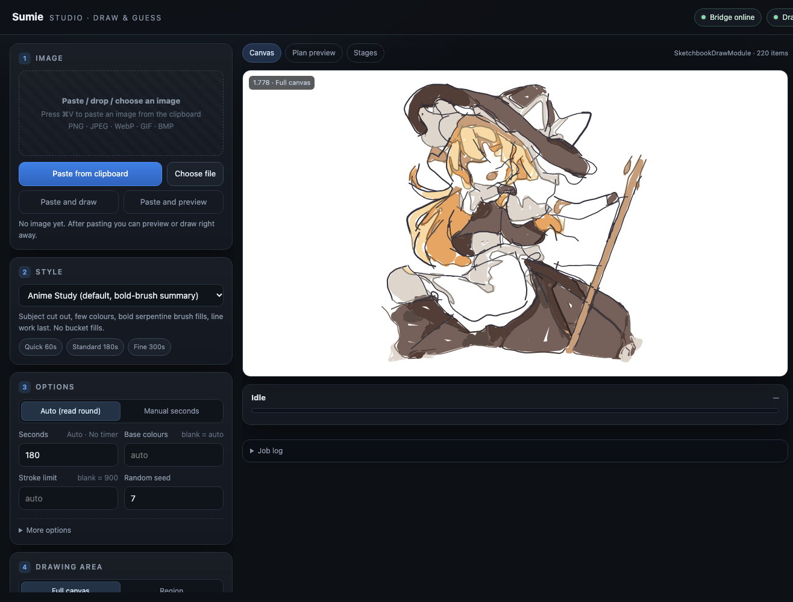

<div align="center">



# Sumie · 墨绘

**Draws an illustration into *Draw & Guess* stroke by stroke — like a person would.**

[](https://github.com/ClarkeLi/sumie/actions/workflows/tests.yml)
[](LICENSE)


[简体中文](README.md) · **English** · [日本語](README.ja.md) · [한국어](README.ko.md) · [Deutsch](README.de.md)

<br>



<sub>Demo: <code>anime_human</code> style, 300 s budget, colour-area borders off (<code>--borders off</code>), sped up. Full quality: <a href="assets/demo.mp4">assets/demo.mp4</a>.</sub>

</div>

---

Sumie is a [BepInEx](https://github.com/BepInEx/BepInEx) plugin for the Steam game **Draw & Guess** plus a local web workbench. Paste an image into the page, preview the plan, press *Draw*: Sumie plans line art, flat colours, shading and details, then draws them stroke by stroke **like a player with a pen tablet** and finishes inside the round's time limit.

> ## ⚠️ Important notice and restrictions
>
> 1. **For learning and technical exchange only.** This project exists to study game-plugin mechanisms, image processing and human–computer interaction. **Commercial use is prohibited**, as is any use that breaks the law or the game's terms of service.
> 2. **Do not use it in online multiplayer games.** Do not use it in public rooms, matchmaking, ranked or tournament play — it would spoil other players' experience and fairness. Use it only in the solo Sketchbook or in a private setting where **every participant explicitly agrees**.
> 3. **Delete it within 24 hours of downloading.** The code, documents and examples are for reading and study only; delete them promptly once you have finished trying or studying them, and do not redistribute them or use them for anything else.
> 4. **At your own risk.** Using this project may violate the game's terms of service and lead to restrictions or bans on your account; you bear all consequences. It is provided "as is" without warranty of any kind, and the author is not liable for any loss.
> 5. **Unofficial.** It is not affiliated with the game's developers; *Draw & Guess* and related trademarks, art and code belong to their respective owners. This project distributes no game files.
> 6. **Copyright.** The illustration in the demo belongs to its original author and is shown only to demonstrate the result; if it infringes your rights, contact us and it will be removed immediately.
>
> By downloading, installing or using this project you confirm that you have read and agree to the above.

> Unofficial fan project, not affiliated with the game's developers. Please read the *Fair play* section below first.

## ✨ Features

- **No mouse emulation.** Strokes go straight into the game's own drawing functions — no accessibility or screen-recording permission, and they use the game's undo and multiplayer sync.
- **`anime_human`: draws like a person.** Every stroke gets its own pen-pressure width (exactly as tablet players do), pacing comes from real doodle statistics (Google *Quick, Draw!*), line art comes first, then colour. Colour is brushed on **virtual layers** under the line art (the plugin cuts the game's 3 sorting layers into 9; other players see them too), falling back to a paint bucket checked against an offline model of the game's fill rules.
- **On time.** It reads the round timer, keeps a safety margin and compresses its pace when needed.
- **Web workbench** at `http://127.0.0.1:8765/`: paste / drop an image → pick a style → preview with numeric metrics → draw → undo / export / restore; live word and countdown.
- **Five UI languages:** 简体中文, English, 日本語, 한국어, Deutsch — follows the browser language, switchable by hand.
- **Six styles:** `anime_human` (recommended), `anime_study`, `anime_flat`, `sketch`, `impasto`, `watercolor`.
- **One-step install,** a full technical whitepaper and an HTTP/WebSocket API.

## 🖥 Web workbench

 

The UI language can be switched at the top right.

## 🏗 Architecture


| Part | Responsibility |
|---|---|
| **Plugin** `DrawGuessBridge.dll` (inside the game) | HTTP/WebSocket bridge on `127.0.0.1:8765`; main-thread dispatch; turns strokes into game elements; virtual pen and layers; starts/stops the Python service |
| **Draw service** `studio_server.py` (local Python, `:8770`) | job queue, perception (line art / subject mask / palette), planning, human model, preview and metrics, stroke-by-stroke execution |
| **Workbench** `ui.html` (served by the plugin) | image, style, options, preview, draw, undo / export / restore, live game state |

Geometry and aesthetics live in Python; C# only moves requests safely onto the Unity main thread. See the [technical whitepaper](docs/whitepaper.en.md).

## 📦 Install

### Requirements

| System | Status | Notes |
|---|---|---|
| macOS · Apple silicon (M1 and later) | ✅ | the game is an x86_64 program and runs through Rosetta 2; `install.sh` installs Rosetta for you |
| macOS · Intel | ✅ | `install.sh` |
| Windows 10 / 11 (x64) | ✅ | `install.ps1` |
| Linux x86_64 (Ubuntu / Debian / Fedora / Arch / SteamOS) | 🧪 experimental | Steam ships a native Linux build and the installer supports it, but it has not been verified on a real machine yet; reports welcome |

Game: Draw & Guess on Steam, **Mono build** (the installer refuses IL2CPP)

Python 3.10 or newer · .NET SDK 6 or newer · a few hundred MB of disk (the optional AI add-on needs ~400 MB of models plus PyTorch).

The plugin is compiled on your machine against the game's own assemblies; nothing from the game is redistributed.

### Option A: one-step installer (recommended)

Install the prerequisites — macOS ([Homebrew](https://brew.sh)):

```bash
brew install python git
brew install --cask dotnet-sdk
```

Windows (PowerShell):

```powershell
winget install Python.Python.3.12
winget install Microsoft.DotNet.SDK.8
winget install Git.Git
```

Linux (Debian / Ubuntu example):

```bash
sudo apt install python3 python3-venv git dotnet-sdk-8.0
```

Open a **new terminal**, download and unzip `Sumie-v1.0.0.zip` from [Releases](https://github.com/ClarkeLi/sumie/releases) (or `git clone https://github.com/ClarkeLi/sumie.git`), **close the game**, then run:

```bash
# macOS (Intel / Apple silicon) or Linux
./install.sh            # add --ai for the AI line-art / segmentation models (best quality, ~400 MB)
```

```powershell
# Windows (PowerShell)
.\install.ps1           # add -Ai for the same
```

The script creates `.venv` inside the folder and installs dependencies → finds the game via your Steam libraries → downloads and verifies BepInEx 6 → builds the plugin → deploys it and writes the config. If the game is not found: `./install.sh --game "/path/to/steamapps/common/Draw & Guess"`. `--check` only reports, `--uninstall` removes the plugin (keeps BepInEx).

### Option B: three manual steps

```bash
git clone https://github.com/ClarkeLi/sumie.git && cd sumie
python3 tools/setup.py [--ai]     # Windows: python tools\setup.py
python3 tools/install.py          # Windows: python tools\install.py
```

Without the AI models it falls back to classical edge detection and GrabCut — it works, at lower quality.

## ▶️ Use

**macOS** needs a one-time Steam launch option: Steam → right-click *Draw & Guess* → Properties → Launch Options, and paste the line the installer printed at the end:

```text
"/…/Draw & Guess/beta/run_bepinex.sh" %command%
```

**Linux** works like macOS: paste the line the installer prints (`"…/run_bepinex.sh" %command%`) into the Steam launch options. Linux support is experimental.

**Windows** needs nothing — start the game from Steam as usual.

Then:

1. In the game open **main menu → Sketchbook → new**, or join a drawing round;
2. open **http://127.0.0.1:8765/** in your browser;
3. paste an image with `⌘V` / `Ctrl+V`, or drop a file;
4. choose **Anime Human**, press **Generate preview** to check the plan, then **Start drawing**.

Smoke test without the game:

```bash
python3 client/dg_artist.py examples/sample.png --style anime_human --time 120 --dry-run --preview .cache/preview.png
```

### Handy command lines

```bash
python3 client/dg_artist.py image.png --style anime_human --time 180                       # draw
python3 client/dg_artist.py image.png --style anime_human --region 0.1,0.1,0.5,0.8         # only a region
python3 client/dg_artist.py image.png --style anime_human --time 120 --dry-run --plan-out plan.json --preview plan.png
```

All options: [docs/usage.md](docs/usage.md); HTTP/WebSocket API: [docs/api-reference.md](docs/api-reference.md) (both in Chinese for now).

## 🎨 Styles

| Style | Character |
|---|---|
| `anime_human` ★ | like a tablet player: pressure widths, human pacing, line art then colour, virtual layers |
| `anime_study` | subject cut out, few colours, bold serpentine fills, line work last (no bucket fills) |
| `anime_flat` | colour areas + centre lines, for flat-colour illustrations |
| `sketch` | centre lines, hatching and a few colour accents |
| `impasto` | layered curved strokes, thick-paint feel |
| `watercolor` | pale colour areas, white space and thin lines |

## 🔄 Update and uninstall

```bash
git pull && ./install.sh          # rebuild and redeploy (Windows: .\install.ps1)
./install.sh --uninstall          # remove the plugin, keep BepInEx
```

After a game update run the installer again; if the game's internals change, the plugin may need code changes.

## 🩺 Troubleshooting

| Problem | What to do |
|---|---|
| `could not find Draw & Guess` | pass the folder with `--game` |
| `a .NET SDK is required` | install it and open a **new terminal** |
| `uses IL2CPP` | this game build is not supported; use the Mono build |
| Page does not load | the plugin is not running. macOS: check the Launch Option. Windows: is `winhttp.dll` next to the game exe? Then read `BepInEx/LogOutput.log` in the game folder |
| Page loads but "Draw service" is red | run the installer again (it rewrites the `[Studio]` paths); moving the folder requires reinstalling |
| `canDraw: false` | you are not on a canvas, or it is not your turn |

## 📚 Documentation

- [Technical Whitepaper (English)](docs/whitepaper.en.md) · [技术白皮书（中文）](docs/whitepaper.zh-CN.md)
- [Docs index](docs/README.md): architecture, API, renderer, `anime_human`, Studio, verification, development (currently Chinese)

## ⚖️ Fair play

Sumie is meant for solo Sketchbook play, private lobbies with friends who agree to it, experiments and learning. Do not use it to gain an unfair edge in public games or to disrupt other players; following the game's terms of service is your responsibility. Making the result look hand-drawn is for aesthetics, not for disguising identity or evading detection.

The web server and the draw service listen on `127.0.0.1` only; if you set a `Token` in the plugin config, API requests must carry it. **Do not expose these ports to a network.**

## 🧪 Development

```bash
python3 -m unittest discover -s tests     # offline, no game needed
python3 tools/make_release.py             # builds releases/Sumie-v<version>.zip
```

See [docs/development.md](docs/development.md).

## 📄 License and credits

[MIT](LICENSE). Third-party components and models are listed in [NOTICE.md](NOTICE.md): Anime2Sketch (MIT), anime-segmentation (Apache-2.0), BepInEx (LGPL-2.1), Google *Quick, Draw!* (CC BY 4.0, summary statistics only). The logo is original to this project. The illustration redrawn in the demo is third-party fan art; its copyright belongs to its author and it is shown only to demonstrate rendering — if the rights holder objects, please contact us and it will be removed. `examples/fox.svg` is an original test image.
