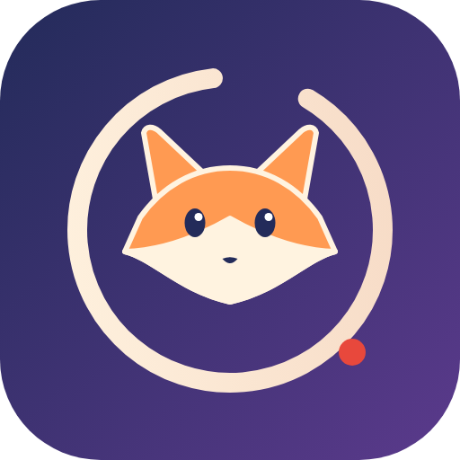
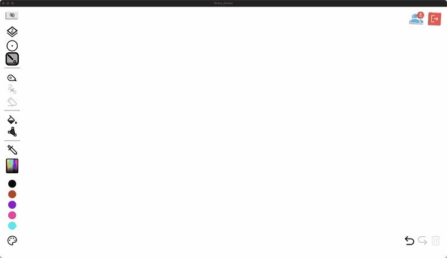
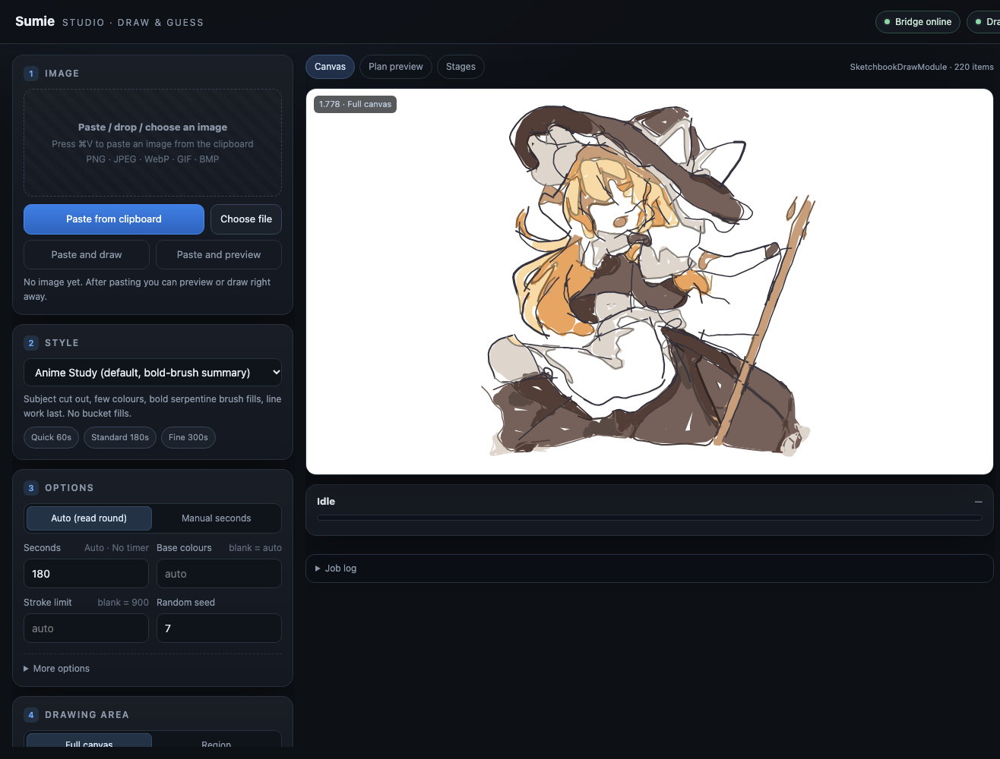

<div align="center">



# Sumie · 墨絵

**イラストを、人が描くように一筆ずつ《Draw & Guess》へ。**

[](https://github.com/ClarkeLi/sumie/actions/workflows/tests.yml)
[](LICENSE)


[简体中文](README.md) · [English](README.en.md) · **日本語** · [한국어](README.ko.md) · [Deutsch](README.de.md)

<br>



<sub>デモ：<code>anime_human</code> スタイル、300 秒の持ち時間、色面の境界線オフ（<code>--borders off</code>）、早送り。高画質版：<a href="assets/demo.mp4">assets/demo.mp4</a></sub>

</div>

---

Sumie は Steam ゲーム **Draw & Guess** 用の [BepInEx](https://github.com/BepInEx/BepInEx) プラグインと、ローカルの Web ワークベンチです。画像をページに貼り付け、計画をプレビューして「描画開始」を押すだけで、線画・ベタ塗り・陰影・ディテールを計画し、**ペンタブレットを使うプレイヤーのように**一筆ずつ描き、ラウンドの制限時間内に仕上げます。

> ## ⚠️ 重要な注意と利用制限
>
> 1. **学習と技術交流のみを目的とします。** 本プロジェクトは、ゲームプラグインの仕組み・画像処理・ヒューマンコンピュータインタラクションを研究するためのものです。**商用利用は禁止**で、法令やゲームの利用規約に反する利用も認められません。
> 2. **オンライン対戦ゲームでは使用しないでください。** 公開ルーム、マッチング、ランク戦、大会などでの使用は、他のプレイヤーの体験と公平性を損なうため禁止です。ひとりで遊ぶスケッチブック、または**参加者全員が明確に同意した**プライベートな環境に限ります。
> 3. **ダウンロード後 24 時間以内に削除してください。** コード・ドキュメント・サンプルは閲覧と学習のためのものです。試用や研究が終わったらすみやかに削除し、再配布や他の目的への利用はしないでください。
> 4. **自己責任でご利用ください。** 本プロジェクトの使用はゲームの利用規約に違反し、アカウントの制限や停止につながる可能性があります。その結果はすべて利用者が負うものとします。本プロジェクトは「現状のまま」提供され、いかなる保証もなく、作者は損害について責任を負いません。
> 5. **非公式です。** ゲーム開発元とは一切関係がありません。*Draw & Guess* および関連する商標・美術・プログラムの権利は、それぞれの権利者に帰属します。本プロジェクトはゲームのファイルを配布しません。
> 6. **著作権。** デモのイラストの著作権は原作者に帰属し、結果の紹介のためにのみ掲載しています。権利を侵害する場合はご連絡ください。ただちに削除します。
>
> 本プロジェクトのダウンロード・インストール・使用により、上記を読み、同意したものとみなします。

> 非公式のファンプロジェクトで、ゲーム開発元とは無関係です。先に下の「フェアプレー」をお読みください。

## ✨ 特長

- **マウス操作のエミュレーションなし。** ストロークはゲーム自身の描画関数に直接渡されるため、アクセシビリティや画面収録の権限は不要で、ゲームの取り消し・マルチプレイ同期にもそのまま乗ります。
- **`anime_human`：人のように描く。** 各ストロークに固有の筆圧の太さ（ペンタブのプレイヤーと同じ）、実際の落書き統計（Google *Quick, Draw!*）に基づくリズム、線画が先・着色が後。色は線画の下の**仮想レイヤー**にブラシで塗ります（プラグインがゲームの 3 つのソートレイヤーを 9 層に分割。他のプレイヤーにも見えます）。非対応時は、ゲームの塗りつぶしルールをオフラインでモデル化して検証したバケツ塗りに切り替えます。
- **時間厳守。** ラウンドタイマーを読み取り、余裕を残し、必要なら自動でペースを圧縮します。
- **Web ワークベンチ** `http://127.0.0.1:8765/`：画像を貼り付け／ドロップ → スタイル選択 → 数値指標付きプレビュー → 描画 → 元に戻す／書き出し／復元。現在のお題とカウントダウンもリアルタイム表示。
- **5 言語 UI：** 简体中文・English・日本語・한국어・Deutsch。ブラウザの言語に自動追従し、手動切替も可能。
- **6 つのスタイル：** `anime_human`（推奨）、`anime_study`、`anime_flat`、`sketch`、`impasto`、`watercolor`。
- **ワンステップのインストール**、詳細な技術ホワイトペーパー、HTTP/WebSocket API。

## 🖥 Web ワークベンチ



画面右上で表示言語を切り替えられます。

## 🏗 アーキテクチャ


| 構成要素 | 役割 |
|---|---|
| **プラグイン** `DrawGuessBridge.dll`（ゲーム内） | `127.0.0.1:8765` の HTTP/WebSocket ブリッジ、メインスレッドへのディスパッチ、ストロークのゲーム要素化、仮想ペンと仮想レイヤー、Python サービスの起動・停止 |
| **描画サービス** `studio_server.py`（ローカル Python、`:8770`） | ジョブキュー、知覚（線画／被写体分割／パレット）、計画、人間モデル、プレビューと指標、一筆ずつの実行 |
| **ワークベンチ** `ui.html`（プラグインが配信） | 画像・スタイル・パラメータ・プレビュー・描画・元に戻す／書き出し／復元・ライブのゲーム状態 |

幾何と美的判断はすべて Python 側にあり、C# は要求を安全に Unity のメインスレッドへ運ぶだけです。詳細は[技術ホワイトペーパー](docs/whitepaper.en.md)（英語／[中国語](docs/whitepaper.zh-CN.md)）をご覧ください。

## 📦 インストール

### 必要環境

| システム | 状態 | 備考 |
|---|---|---|
| macOS · Apple シリコン（M1 以降） | ✅ | ゲーム自体が x86_64 プログラムのため Rosetta 2 経由で動作します。`install.sh` が Rosetta を自動導入します |
| macOS · Intel | ✅ | `install.sh` |
| Windows 10 / 11（x64） | ✅ | `install.ps1` |
| Linux x86_64（Ubuntu / Debian / Fedora / Arch / SteamOS） | 🧪 試験的 | Steam にネイティブ Linux 版があり、インストーラも対応していますが、実機ではまだ検証していません。不具合報告歓迎 |

ゲーム: Steam の Draw & Guess、**Mono 版**（IL2CPP 版はインストーラが拒否します）

Python 3.10 以上 · .NET SDK 6 以上 · ディスク数百 MB（任意の AI 追加コンポーネントはモデル約 400 MB と PyTorch）。

プラグインはお使いの PC 上でゲーム自身のアセンブリに対してビルドされ、ゲームのファイルは一切再配布されません。

### 方法 A：ワンステップインストーラ（推奨）

前提ソフトをインストールします。macOS（[Homebrew](https://brew.sh)）：

```bash
brew install python git
brew install --cask dotnet-sdk
```

Windows（PowerShell）：

```powershell
winget install Python.Python.3.12
winget install Microsoft.DotNet.SDK.8
winget install Git.Git
```

Linux（Debian / Ubuntu の例）：

```bash
sudo apt install python3 python3-venv git dotnet-sdk-8.0
```

**新しいターミナル**を開き、[Releases](https://github.com/ClarkeLi/sumie/releases) から `Sumie-v1.0.0.zip` をダウンロードして展開（または `git clone https://github.com/ClarkeLi/sumie.git`）し、**ゲームを終了してから**実行します。

```bash
# macOS（Intel / Apple シリコン）または Linux
./install.sh            # --ai で AI の線画／分割モデルも導入（最高品質、約 400 MB）
```

```powershell
# Windows（PowerShell）
.\install.ps1           # -Ai で同様
```

スクリプトは、フォルダ内に `.venv` を作成して依存関係を導入 → Steam ライブラリからゲームを検出 → BepInEx 6 をダウンロードして検証 → プラグインをビルド → 配置して設定を書き込み、の順に処理します。ゲームが見つからない場合：`./install.sh --game "/path/to/steamapps/common/Draw & Guess"`。`--check` は確認のみ、`--uninstall` はプラグインを削除します（BepInEx は残ります）。

### 方法 B：手動 3 ステップ

```bash
git clone https://github.com/ClarkeLi/sumie.git && cd sumie
python3 tools/setup.py [--ai]     # Windows: python tools\setup.py
python3 tools/install.py          # Windows: python tools\install.py
```

AI モデルがない場合は従来のエッジ検出と GrabCut に切り替わります。動作はしますが品質は下がります。

## ▶️ 使い方

**macOS** では Steam の起動オプションを一度だけ設定します。Steam → *Draw & Guess* を右クリック → プロパティ → 起動オプション に、インストーラが最後に表示した行を貼り付けます。

```text
"/…/Draw & Guess/beta/run_bepinex.sh" %command%
```

**Linux** も macOS と同様に、インストーラが表示した行（`"…/run_bepinex.sh" %command%`）を Steam の起動オプションに貼り付けます。Linux 対応は試験的です。

**Windows** では設定不要です。いつも通り Steam から起動してください。

その後：

1. ゲームで **メインメニュー → スケッチブック → 新規作成**、または描画ラウンドに参加します。
2. ブラウザで **http://127.0.0.1:8765/** を開きます。
3. `⌘V` / `Ctrl+V` で画像を貼り付けるか、ファイルをドロップします。
4. スタイルに **Anime Human** を選び、**プレビュー生成**で計画を確認してから**描画開始**を押します。

ゲームなしの動作確認：

```bash
python3 client/dg_artist.py examples/sample.png --style anime_human --time 120 --dry-run --preview .cache/preview.png
```

### よく使うコマンド

```bash
python3 client/dg_artist.py image.png --style anime_human --time 180                       # 描画
python3 client/dg_artist.py image.png --style anime_human --region 0.1,0.1,0.5,0.8         # 範囲のみ
python3 client/dg_artist.py image.png --style anime_human --time 120 --dry-run --plan-out plan.json --preview plan.png
```

全オプションは [docs/usage.md](docs/usage.md)、API は [docs/api-reference.md](docs/api-reference.md)（現在は中国語）。

## 🎨 スタイル

| スタイル | 特徴 |
|---|---|
| `anime_human` ★ | ペンタブのプレイヤーのように：筆圧の太さ、人間らしいリズム、線画→着色、仮想レイヤー |
| `anime_study` | 被写体を切り抜き、少色・太筆の蛇行塗り、最後に線（塗りつぶしなし） |
| `anime_flat` | 色面＋中心線。フラット塗りのイラスト向け |
| `sketch` | 中心線、ハッチング、少量の色のアクセント |
| `impasto` | 重ねた曲線ストロークによる厚塗り |
| `watercolor` | 淡い色面、余白、細い線 |

## 🔄 更新とアンインストール

```bash
git pull && ./install.sh          # 再ビルドして再配置（Windows: .\install.ps1）
./install.sh --uninstall          # プラグインを削除（BepInEx は残す）
```

ゲームのアップデート後はインストーラを再実行してください。ゲーム内部が変わった場合、プラグインのコード修正が必要になることがあります。

## 🩺 トラブルシューティング

| 症状 | 対処 |
|---|---|
| `could not find Draw & Guess` | `--game` でフォルダを指定 |
| `a .NET SDK is required` | インストール後に**新しいターミナル**を開く |
| `uses IL2CPP` | このゲームビルドは非対応です。Mono 版を使用してください |
| ページが開かない | プラグインが動いていません。macOS は起動オプションを確認、Windows はゲーム exe の隣に `winhttp.dll` があるか確認し、ゲームフォルダの `BepInEx/LogOutput.log` を見てください |
| ページは開くが「描画サービス」が赤い | インストーラを再実行（`[Studio]` のパスを書き直します）。フォルダを移動した場合は再インストールが必要です |
| `canDraw: false` | キャンバスに入っていないか、自分の番ではありません |

## 📚 ドキュメント

- [技術ホワイトペーパー（English）](docs/whitepaper.en.md) · [技术白皮书（中文）](docs/whitepaper.zh-CN.md)
- [ドキュメント索引](docs/README.md)：アーキテクチャ、API、レンダラー、`anime_human`、Studio、検証、開発（現在は中国語）

## ⚖️ フェアプレー

Sumie は、ひとりで遊ぶスケッチブック、同意した友人とのプライベートルーム、実験や学習のためのものです。公開対戦で不当な優位を得たり、他のプレイヤーの妨げになる使い方はしないでください。ゲームの利用規約を守る責任は利用者にあります。仕上がりや描画過程を手描き風にするのは見た目のためであり、身元の偽装や検知の回避のためではありません。

Web サーバーと描画サービスは `127.0.0.1` のみで待ち受けます。プラグイン設定で `Token` を設定した場合、API リクエストはそれを付ける必要があります。**これらのポートをネットワークに公開しないでください。**

## 🧪 開発

```bash
python3 -m unittest discover -s tests     # オフラインテスト（ゲーム不要）
python3 tools/make_release.py             # releases/Sumie-v<version>.zip を生成
```

詳しくは [docs/development.md](docs/development.md) をご覧ください。

## 📄 ライセンスと謝辞

[MIT](LICENSE)。サードパーティのコンポーネントとモデルは [NOTICE.md](NOTICE.md) に記載：Anime2Sketch（MIT）、anime-segmentation（Apache-2.0）、BepInEx（LGPL-2.1）、Google *Quick, Draw!*（CC BY 4.0、要約統計のみ）。ロゴは本プロジェクトのオリジナルです。デモで描き直しているイラストは第三者のファン作品で、著作権は作者に帰属し、描画の見本としてのみ掲載しています。権利者からの申し立てがあれば削除します。`examples/fox.svg` は本プロジェクト作成のテスト画像です。
