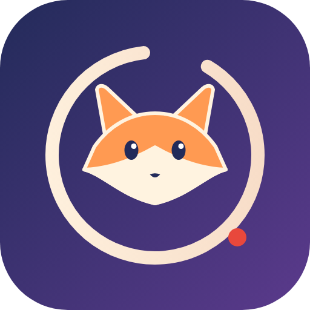
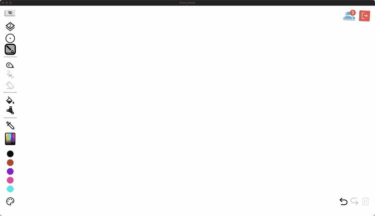
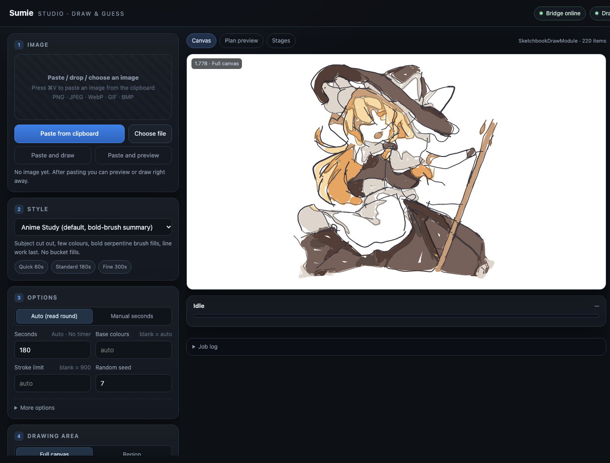

<div align="center">



# Sumie · 墨绘

**일러스트를 사람이 그리듯 한 획씩 《Draw & Guess》에 그려 넣습니다.**

[](https://github.com/ClarkeLi/sumie/actions/workflows/tests.yml)
[](LICENSE)


[简体中文](README.md) · [English](README.en.md) · [日本語](README.ja.md) · **한국어** · [Deutsch](README.de.md)

<br>



<sub>데모: <code>anime_human</code> 스타일, 제한 시간 300초, 색면 경계선 끔(<code>--borders off</code>), 배속 재생. 고화질: <a href="assets/demo.mp4">assets/demo.mp4</a></sub>

</div>

---

Sumie는 Steam 게임 **Draw & Guess**용 [BepInEx](https://github.com/BepInEx/BepInEx) 플러그인과 로컬 웹 작업대입니다. 이미지를 페이지에 붙여넣고 계획을 미리본 뒤 "그리기 시작"을 누르면 선화·평면 채색·음영·디테일을 계획하고, **펜 타블렛을 쓰는 플레이어처럼** 한 획씩 그려 라운드 제한 시간 안에 끝냅니다.

> ## ⚠️ 중요 고지 및 사용 제한
>
> 1. **학습과 기술 교류 목적으로만 사용하세요.** 이 프로젝트는 게임 플러그인 구조, 이미지 처리, 인간-컴퓨터 상호작용을 연구하기 위한 것입니다. **상업적 이용은 금지**되며, 법령이나 게임 이용약관을 위반하는 모든 사용도 허용되지 않습니다.
> 2. **온라인 멀티플레이 게임에서는 사용하지 마세요.** 공개 방, 매치메이킹, 랭크전, 대회 등에서 사용하면 다른 플레이어의 경험과 공정성을 해치므로 금지됩니다. 혼자 하는 스케치북이거나 **모든 참가자가 명시적으로 동의한** 비공개 환경에서만 사용하세요.
> 3. **다운로드 후 24시간 이내에 삭제하세요.** 코드, 문서, 예제는 열람과 학습용입니다. 사용해 보거나 연구를 마쳤다면 즉시 삭제하고, 재배포하거나 다른 용도로 쓰지 마세요.
> 4. **사용에 따른 책임은 본인에게 있습니다.** 이 프로젝트의 사용은 게임 이용약관을 위반해 계정 제한이나 정지로 이어질 수 있으며, 그 모든 결과는 사용자가 부담합니다. 이 프로젝트는 "있는 그대로" 제공되며 어떠한 보증도 없고, 작성자는 어떤 손해에도 책임지지 않습니다.
> 5. **비공식 프로젝트입니다.** 게임 개발사와 아무런 관련이 없으며, *Draw & Guess* 및 관련 상표·미술·프로그램의 권리는 각 권리자에게 있습니다. 이 프로젝트는 게임 파일을 배포하지 않습니다.
> 6. **저작권.** 데모에 사용된 일러스트의 저작권은 원작자에게 있으며 결과 시연용으로만 표시됩니다. 권리를 침해한다면 연락해 주세요. 즉시 삭제하겠습니다.
>
> 이 프로젝트를 다운로드·설치·사용하면 위 내용을 읽고 동의한 것으로 간주합니다.

> 비공식 팬 프로젝트이며 게임 개발사와 무관합니다. 먼저 아래의 "공정한 플레이"를 읽어 주세요.

## ✨ 특징

- **마우스 에뮬레이션 없음.** 획을 게임 자체의 그리기 함수에 직접 전달하므로 손쉬운 사용·화면 녹화 권한이 필요 없고, 게임의 실행 취소와 멀티플레이 동기화를 그대로 탑니다.
- **`anime_human`: 사람처럼 그리기.** 획마다 고유한 필압 굵기(타블렛 플레이어와 동일), 실제 낙서 통계(Google *Quick, Draw!*)에서 얻은 리듬, 선화 먼저 채색은 나중에. 색은 선화 아래 **가상 레이어**에 브러시로 칠합니다(플러그인이 게임의 정렬 레이어 3개를 9개로 나눔, 다른 플레이어에게도 보임). 지원되지 않으면 게임의 채우기 규칙을 오프라인으로 모델링해 검증한 페인트통으로 돌아갑니다.
- **시간 엄수.** 라운드 타이머를 읽고 여유를 남기며 필요하면 속도를 자동으로 압축합니다.
- **웹 작업대** `http://127.0.0.1:8765/`: 이미지 붙여넣기 / 드롭 → 스타일 선택 → 수치 지표가 있는 미리보기 → 그리기 → 실행 취소 / 내보내기 / 복원. 현재 단어와 카운트다운을 실시간 표시합니다.
- **5개 언어 UI:** 简体中文, English, 日本語, 한국어, Deutsch. 브라우저 언어를 따르며 수동 전환도 가능합니다.
- **6가지 스타일:** `anime_human`(권장), `anime_study`, `anime_flat`, `sketch`, `impasto`, `watercolor`.
- **원스텝 설치**, 상세한 기술 백서, HTTP/WebSocket API.

## 🖥 웹 작업대



오른쪽 위에서 UI 언어를 바꿀 수 있습니다.

## 🏗 아키텍처


| 구성 요소 | 역할 |
|---|---|
| **플러그인** `DrawGuessBridge.dll` (게임 프로세스 내부) | `127.0.0.1:8765` HTTP/WebSocket 브리지, 메인 스레드 디스패치, 획을 게임 요소로 변환, 가상 펜과 가상 레이어, Python 서비스 시작/중지 |
| **그리기 서비스** `studio_server.py` (로컬 Python, `:8770`) | 작업 큐, 인지(선화 / 피사체 분할 / 팔레트), 계획, 인간 모델, 미리보기와 지표, 획 단위 실행 |
| **작업대** `ui.html` (플러그인이 제공) | 이미지, 스타일, 매개변수, 미리보기, 그리기, 실행 취소 / 내보내기 / 복원, 실시간 게임 상태 |

기하와 미적 판단은 모두 Python에 있고 C#은 요청을 Unity 메인 스레드로 안전하게 옮기기만 합니다. 자세한 내용은 [기술 백서](docs/whitepaper.en.md)(영어 / [중국어](docs/whitepaper.zh-CN.md))를 참고하세요.

## 📦 설치

### 요구 사항

| 시스템 | 상태 | 비고 |
|---|---|---|
| macOS · Apple 실리콘 (M1 이후) | ✅ | 게임 자체가 x86_64 프로그램이라 Rosetta 2로 실행됩니다. `install.sh`가 Rosetta를 자동 설치합니다 |
| macOS · Intel | ✅ | `install.sh` |
| Windows 10 / 11 (x64) | ✅ | `install.ps1` |
| Linux x86_64 (Ubuntu / Debian / Fedora / Arch / SteamOS) | 🧪 실험적 | Steam에 네이티브 Linux 빌드가 있고 설치 프로그램도 지원하지만 아직 실제 기기에서 검증하지 못했습니다. 제보 환영 |

게임: Steam의 Draw & Guess, **Mono 빌드** (IL2CPP 빌드는 설치 프로그램이 거부)

Python 3.10 이상 · .NET SDK 6 이상 · 디스크 수백 MB (선택 사항인 AI 구성요소는 모델 약 400 MB + PyTorch).

플러그인은 사용자의 컴퓨터에서 게임 자체 어셈블리를 기준으로 빌드되며, 게임 파일은 일절 재배포하지 않습니다.

### 방법 A: 원스텝 설치 프로그램 (권장)

먼저 필수 프로그램을 설치합니다. macOS ([Homebrew](https://brew.sh)):

```bash
brew install python git
brew install --cask dotnet-sdk
```

Windows (PowerShell):

```powershell
winget install Python.Python.3.12
winget install Microsoft.DotNet.SDK.8
winget install Git.Git
```

Linux (Debian / Ubuntu 예시):

```bash
sudo apt install python3 python3-venv git dotnet-sdk-8.0
```

**새 터미널**을 열고 [Releases](https://github.com/ClarkeLi/sumie/releases)에서 `Sumie-v1.0.0.zip`을 받아 압축을 풀거나(`git clone https://github.com/ClarkeLi/sumie.git`), **게임을 종료한 뒤** 실행하세요.

```bash
# macOS (Intel / Apple 실리콘) 또는 Linux
./install.sh            # --ai 로 AI 선화/분할 모델까지 설치 (최고 품질, 약 400 MB)
```

```powershell
# Windows (PowerShell)
.\install.ps1           # -Ai 도 동일
```

스크립트는 폴더 안에 `.venv`를 만들고 의존성 설치 → Steam 라이브러리에서 게임 탐색 → BepInEx 6 다운로드 및 검증 → 플러그인 빌드 → 배포 및 설정 기록 순으로 진행합니다. 게임을 찾지 못하면 `./install.sh --game "/path/to/steamapps/common/Draw & Guess"`. `--check`는 점검만, `--uninstall`은 플러그인을 제거합니다(BepInEx 유지).

### 방법 B: 수동 3단계

```bash
git clone https://github.com/ClarkeLi/sumie.git && cd sumie
python3 tools/setup.py [--ai]     # Windows: python tools\setup.py
python3 tools/install.py          # Windows: python tools\install.py
```

AI 모델이 없으면 고전적 에지 검출과 GrabCut으로 대체됩니다. 동작은 하지만 품질이 낮아집니다.

## ▶️ 사용법

**macOS**는 Steam 실행 옵션을 한 번만 설정하면 됩니다. Steam → *Draw & Guess* 우클릭 → 속성 → 실행 옵션에 설치 프로그램이 마지막에 출력한 줄을 붙여넣으세요.

```text
"/…/Draw & Guess/beta/run_bepinex.sh" %command%
```

**Linux**도 macOS와 같습니다. 설치 프로그램이 출력한 줄(`"…/run_bepinex.sh" %command%`)을 Steam 실행 옵션에 붙여넣으세요. Linux 지원은 실험적입니다.

**Windows**는 설정이 필요 없습니다. 평소처럼 Steam에서 게임을 실행하세요.

그다음:

1. 게임에서 **메인 메뉴 → 스케치북 → 새로 만들기**를 선택하거나 그림 라운드에 참가합니다.
2. 브라우저에서 **http://127.0.0.1:8765/** 를 엽니다.
3. `⌘V` / `Ctrl+V`로 이미지를 붙여넣거나 파일을 끌어다 놓습니다.
4. 스타일을 **Anime Human**으로 고르고 **미리보기 생성**으로 계획을 확인한 뒤 **그리기 시작**을 누릅니다.

게임 없이 동작 확인:

```bash
python3 client/dg_artist.py examples/sample.png --style anime_human --time 120 --dry-run --preview .cache/preview.png
```

### 자주 쓰는 명령줄

```bash
python3 client/dg_artist.py image.png --style anime_human --time 180                       # 그리기
python3 client/dg_artist.py image.png --style anime_human --region 0.1,0.1,0.5,0.8         # 일부 영역만
python3 client/dg_artist.py image.png --style anime_human --time 120 --dry-run --plan-out plan.json --preview plan.png
```

전체 옵션은 [docs/usage.md](docs/usage.md), API는 [docs/api-reference.md](docs/api-reference.md) (현재 중국어).

## 🎨 스타일

| 스타일 | 특징 |
|---|---|
| `anime_human` ★ | 타블렛 플레이어처럼: 필압 굵기, 사람 같은 리듬, 선화 → 채색, 가상 레이어 |
| `anime_study` | 피사체 오려내기, 적은 색, 굵은 붓의 뱀 모양 채색, 마지막에 선 (채우기 없음) |
| `anime_flat` | 색면 + 중심선, 플랫 채색 일러스트에 적합 |
| `sketch` | 중심선, 해칭, 약간의 색 포인트 |
| `impasto` | 여러 겹의 곡선 붓터치, 두꺼운 질감 |
| `watercolor` | 옅은 색면, 여백, 가는 선 |

## 🔄 업데이트와 제거

```bash
git pull && ./install.sh          # 다시 빌드하고 배포 (Windows: .\install.ps1)
./install.sh --uninstall          # 플러그인 제거 (BepInEx 유지)
```

게임 업데이트 후에는 설치 프로그램을 다시 실행하세요. 게임 내부 구조가 바뀌면 플러그인 코드 수정이 필요할 수 있습니다.

## 🩺 문제 해결

| 증상 | 해결 |
|---|---|
| `could not find Draw & Guess` | `--game`으로 폴더 지정 |
| `a .NET SDK is required` | 설치 후 **새 터미널** 열기 |
| `uses IL2CPP` | 지원하지 않는 게임 빌드입니다. Mono 빌드를 사용하세요 |
| 페이지가 열리지 않음 | 플러그인이 실행 중이 아닙니다. macOS는 실행 옵션 확인, Windows는 게임 exe 옆에 `winhttp.dll`이 있는지 확인하고 게임 폴더의 `BepInEx/LogOutput.log`를 보세요 |
| 페이지는 열리는데 "그리기 서비스"가 빨간색 | 설치 프로그램을 다시 실행(`[Studio]` 경로를 다시 씀). 폴더를 옮겼다면 재설치가 필요합니다 |
| `canDraw: false` | 캔버스에 들어가지 않았거나 내 차례가 아닙니다 |

## 📚 문서

- [기술 백서 (English)](docs/whitepaper.en.md) · [技术白皮书 (中文)](docs/whitepaper.zh-CN.md)
- [문서 색인](docs/README.md): 아키텍처, API, 렌더러, `anime_human`, Studio, 검증, 개발 (현재 중국어)

## ⚖️ 공정한 플레이

Sumie는 혼자 하는 스케치북, 동의한 친구와의 비공개 방, 실험과 학습을 위한 것입니다. 공개 대전에서 부당한 이점을 얻거나 다른 플레이어를 방해하는 데 사용하지 마세요. 게임 이용약관을 지킬 책임은 사용자에게 있습니다. 결과물과 그리는 과정을 손그림처럼 보이게 하는 것은 보기 좋게 하려는 것이지 신원을 숨기거나 탐지를 피하려는 것이 아닙니다.

웹 서버와 그리기 서비스는 `127.0.0.1`에서만 수신합니다. 플러그인 설정에 `Token`을 지정하면 API 요청에 반드시 포함해야 합니다. **이 포트를 네트워크에 노출하지 마세요.**

## 🧪 개발

```bash
python3 -m unittest discover -s tests     # 오프라인 테스트 (게임 불필요)
python3 tools/make_release.py             # releases/Sumie-v<version>.zip 생성
```

자세한 내용은 [docs/development.md](docs/development.md)를 참고하세요.

## 📄 라이선스와 크레딧

[MIT](LICENSE). 서드파티 구성요소와 모델은 [NOTICE.md](NOTICE.md)에 있습니다: Anime2Sketch (MIT), anime-segmentation (Apache-2.0), BepInEx (LGPL-2.1), Google *Quick, Draw!* (CC BY 4.0, 요약 통계만). 로고는 이 프로젝트의 오리지널입니다. 데모에서 다시 그린 일러스트는 제3자의 팬 작품이며 저작권은 원작자에게 있고 렌더링 시연용으로만 사용됩니다. 권리자가 이의를 제기하면 삭제하겠습니다. `examples/fox.svg`는 이 프로젝트가 만든 테스트 이미지입니다.
