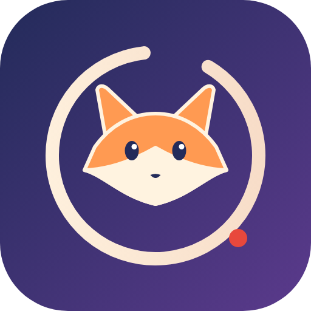
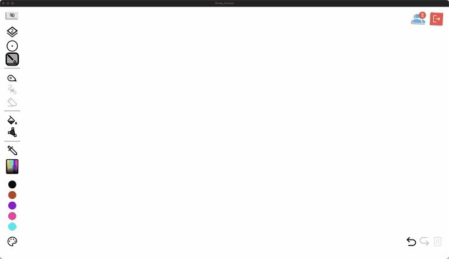
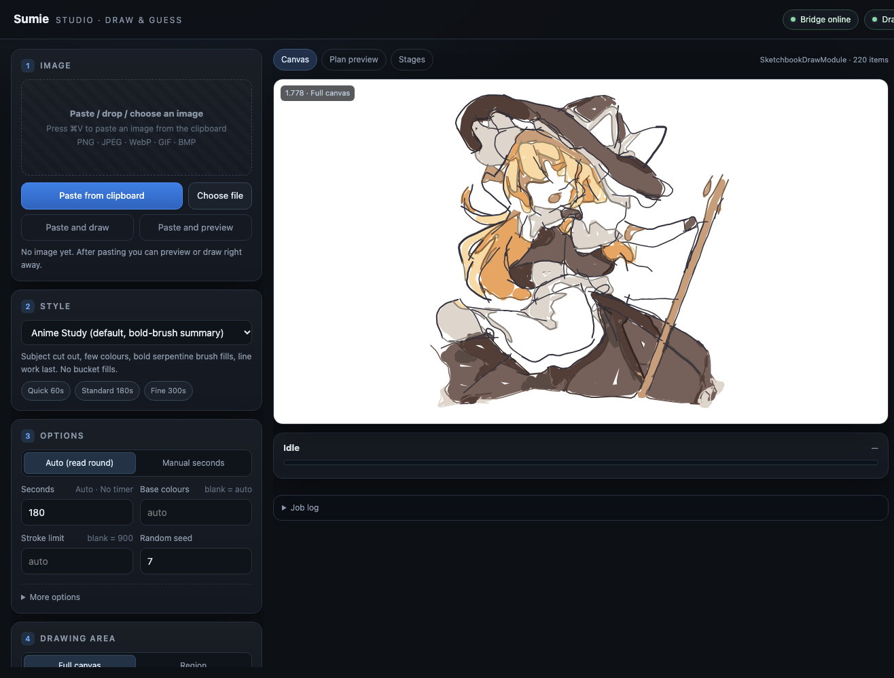
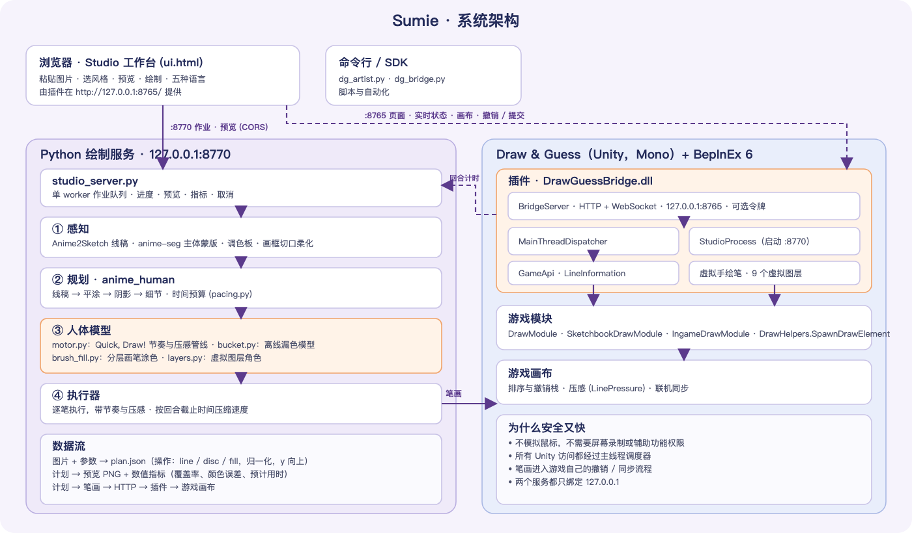
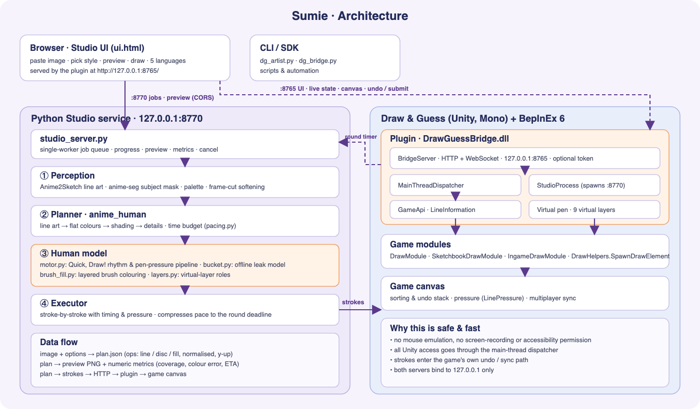

<div align="center">



# Sumie · 墨绘

**像人一样，把一张插画一笔一笔画进《Draw & Guess》**

[](https://github.com/ClarkeLi/sumie/actions/workflows/tests.yml)
[](LICENSE)


**简体中文** · [English](README.en.md) · [日本語](README.ja.md) · [한국어](README.ko.md) · [Deutsch](README.de.md)

<br>



<sub>演示：<code>anime_human</code> 风格，300 秒预算，关闭“色块边界线”选项（<code>--borders off</code>）。画面经过加速；高清版见 <a href="assets/demo.mp4">assets/demo.mp4</a>。</sub>

</div>

---

Sumie 是 Steam 游戏 **Draw & Guess** 的一个 [BepInEx](https://github.com/BepInEx/BepInEx) 插件，加上一个本机网页工作台。把图片粘贴进网页，预览计划，点一下“开始绘制”，它就会规划出线稿、平涂、阴影和细节，然后**像用手绘板的玩家一样**逐笔画在游戏画布上，并严格在回合时间内完成。

> ## ⚠️ 重要声明与使用限制
>
> 1. **仅限学习与技术交流。** 本项目用于研究游戏插件机制、图像处理与人机交互，**禁止任何商业用途**，也不得用于任何违反法律法规或游戏服务条款的行为。
> 2. **禁止在线上联机游戏中使用。** 不得在公开房间、匹配 / 排位 / 比赛等线上对局中使用，以免破坏其他玩家的游戏体验与公平性；仅限单人 Sketchbook，或**所有参与者都明确同意**的私人环境。
> 3. **请在下载后 24 小时内删除。** 代码、文档与示例仅供阅读学习，试用或研究完毕请及时删除，不得二次传播或另作他用。
> 4. **风险自负。** 使用本项目可能违反游戏的服务条款并导致账号受限或封禁，由此产生的一切后果由使用者自行承担；本项目按“原样”提供，不附带任何担保，作者不对任何损失负责。
> 5. **非官方项目。** 与游戏开发者没有任何关联；*Draw & Guess* 及相关商标、美术、程序版权归其各自所有者。本项目不分发任何游戏文件。
> 6. **版权。** 演示中的插图版权归原作者所有，仅用于展示效果；如有侵权请联系我们，将立即删除。
>
> 下载、安装或使用本项目，即视为你已阅读并同意以上声明。

> 非官方同人项目，与游戏开发者无关。请先阅读下方的「公平游戏」一节。

## ✨ 特色

- **不模拟鼠标**：笔画直接交给游戏自己的绘制函数，不需要辅助功能 / 屏幕录制权限，进入游戏自己的撤销与联机同步。
- **`anime_human`，像人一样画**：每笔有各自的压感粗细（和手绘板玩家一样），节奏来自真人涂鸦统计（Google *Quick, Draw!*），先线稿、后上色；颜色用画笔画在线稿下面的**虚拟图层**上（插件把游戏的 3 个排序层切成 9 层，其他玩家也看得到），不支持时退回经离线模型检验的油漆桶。
- **守时**：读取回合计时器、留安全余量，必要时自动压缩节奏；绝不超时。
- **网页工作台** `http://127.0.0.1:8765/`：粘贴 / 拖入图片 → 选风格 → 预览与数值指标 → 绘制 → 撤销 / 导出 / 恢复；实时显示当前词与倒计时。
- **五语言界面**：简体中文、English、日本語、한국어、Deutsch，自动跟随浏览器语言，也可手动切换。
- **六种风格**：`anime_human`（推荐）、`anime_study`、`anime_flat`、`sketch`、`impasto`、`watercolor`。
- **一站式安装**：一条命令完成依赖、构建和部署；附完整技术白皮书与 HTTP/WebSocket API。

## 🖥 网页工作台

 

界面语言可在右上角切换。

## 🏗 架构





| 部分 | 职责 |
|---|---|
| **插件** `DrawGuessBridge.dll`（游戏进程内） | `127.0.0.1:8765` 的 HTTP/WebSocket 桥接；主线程调度；把笔画变成游戏元素；虚拟手绘笔与虚拟图层；按配置启停 Python 服务 |
| **绘制服务** `studio_server.py`（本机 Python，`:8770`） | 作业队列、感知（线稿 / 主体分割 / 调色板）、规划、人体模型、预览与指标、逐笔执行 |
| **工作台** `ui.html`（由插件提供） | 图片、风格、参数、预览、绘制、撤销 / 导出 / 恢复、实时游戏状态 |

几何与审美都在 Python；C# 只负责把请求安全搬到 Unity 主线程。详见 [技术白皮书](docs/whitepaper.zh-CN.md)。

## 📦 安装

### 环境要求

| 系统 | 状态 | 说明 |
|---|---|---|
| macOS · Apple 芯片（M1 及以后） | ✅ | 游戏本身是 x86_64 程序，经 Rosetta 2 运行；`install.sh` 会自动安装 Rosetta |
| macOS · Intel | ✅ | `install.sh` |
| Windows 10 / 11（x64） | ✅ | `install.ps1` |
| Linux x86_64（Ubuntu / Debian / Fedora / Arch / SteamOS） | 🧪 实验性 | Steam 上有原生 Linux 版，安装器已适配，但作者尚未在真机验证；遇到问题欢迎反馈 |

游戏: Steam 上的 Draw & Guess，**Mono 版**（IL2CPP 版会被安装器拒绝）

Python 3.10 或更新 · .NET SDK 6 或更新 · 磁盘数百 MB（可选 AI 组件约 400 MB 模型 + PyTorch）。

插件在你的机器上针对游戏自己的程序集编译，本仓库不分发任何游戏文件。

### 方式 A：一键安装（推荐）

先安装依赖——macOS（[Homebrew](https://brew.sh)）：

```bash
brew install python git
brew install --cask dotnet-sdk
```

Windows（PowerShell）：

```powershell
winget install Python.Python.3.12
winget install Microsoft.DotNet.SDK.8
winget install Git.Git
```

Linux（以 Debian / Ubuntu 为例）：

```bash
sudo apt install python3 python3-venv git dotnet-sdk-8.0
```

然后**新开一个终端**，从 [Releases](https://github.com/ClarkeLi/sumie/releases) 下载并解压 `Sumie-v1.0.0.zip`（或 `git clone https://github.com/ClarkeLi/sumie.git`），**先关闭游戏**，再运行：

```bash
# macOS（Intel / Apple 芯片）或 Linux
./install.sh            # 加 --ai 安装 AI 线稿/分割模型（效果最好，约 400 MB）
```

```powershell
# Windows（PowerShell）
.\install.ps1           # 加 -Ai 同上
```

脚本会：创建仓库内的 `.venv` 并安装依赖 → 通过 Steam 库找到游戏 → 下载并校验 BepInEx 6 → 构建插件 → 部署并写入配置。找不到游戏时：`./install.sh --game "/path/to/steamapps/common/Draw & Guess"`。`--check` 只检查不改动，`--uninstall` 卸载插件（保留 BepInEx）。

### 方式 B：手动三步

```bash
git clone https://github.com/ClarkeLi/sumie.git && cd sumie
python3 tools/setup.py [--ai]     # Windows: python tools\setup.py
python3 tools/install.py          # Windows: python tools\install.py
```

没有 AI 模型时会回退到经典边缘检测与 GrabCut，仍可使用，质量较低。

## ▶️ 使用

**macOS** 需要一次性设置 Steam 启动项：Steam → 右键 *Draw & Guess* → 属性 → 启动选项，粘贴安装器最后打印的那一行，形如：

```text
"/…/Draw & Guess/beta/run_bepinex.sh" %command%
```

**Linux** 与 macOS 类似：在 Steam 启动选项里粘贴安装器打印的那一行（`"…/run_bepinex.sh" %command%`）。Linux 支持为实验性。

**Windows** 无需设置，照常从 Steam 启动游戏。

然后：

1. 进入游戏，打开 **主菜单 → 草图（Sketchbook）→ 新建**，或加入一局绘画回合；
2. 浏览器打开 **http://127.0.0.1:8765/**；
3. `⌘V` / `Ctrl+V` 粘贴图片，或拖入文件；
4. 风格选 **Anime Human**，点 **生成预览** 检查计划，再点 **开始绘制**。

没有游戏也可以冒烟测试：

```bash
python3 client/dg_artist.py examples/sample.png --style anime_human --time 120 --dry-run --preview .cache/preview.png
```

### 常用命令行

```bash
python3 client/dg_artist.py 图片.png --style anime_human --time 180        # 直接画
python3 client/dg_artist.py 图片.png --style anime_human --region 0.1,0.1,0.5,0.8   # 只画选区
python3 client/dg_artist.py 图片.png --style anime_human --time 120 --dry-run --plan-out plan.json --preview plan.png
```

完整参数见 [docs/usage.md](docs/usage.md)；HTTP/WebSocket 接口见 [docs/api-reference.md](docs/api-reference.md)。

## 🎨 风格

| 风格 | 特点 |
|---|---|
| `anime_human` ★ | 像手绘板玩家：压感粗细、真人节奏、先线稿后涂色、虚拟图层 |
| `anime_study` | 主体去背景、少色、粗笔蛇形涂色，最后勾线（无填充） |
| `anime_flat` | 色块 + 中心线，适合平涂插画 |
| `sketch` | 中心线、排线与少量颜色点缀 |
| `impasto` | 多层曲线笔触，厚涂质感 |
| `watercolor` | 浅色块、留白与细线 |

## 🔄 更新与卸载

```bash
git pull && ./install.sh          # 重新构建并部署（Windows: .\install.ps1）
./install.sh --uninstall          # 卸载插件，保留 BepInEx
```

游戏大版本更新后请重新运行安装器；如果游戏内部类变化，插件可能需要改代码。

## 🩺 排错

| 现象 | 处理 |
|---|---|
| `could not find Draw & Guess` | 用 `--game` 指定游戏所在文件夹 |
| `a .NET SDK is required` | 安装后**新开终端** |
| `uses IL2CPP` | 此游戏构建不受支持，请使用 Mono 版 |
| 网页打不开 | 插件没有运行。macOS 检查启动项；Windows 检查游戏 exe 旁是否有 `winhttp.dll`；再看游戏目录 `BepInEx/LogOutput.log` |
| 页面打开但“绘制服务”是红色 | 重新运行安装器（会重写 `[Studio]` 路径）；移动了文件夹需要重新安装 |
| `canDraw: false` | 没有进入画布，或还没轮到你 |

## 📚 文档

- [技术白皮书（中文）](docs/whitepaper.zh-CN.md) · [Technical Whitepaper (English)](docs/whitepaper.en.md)
- [文档索引](docs/README.md)：架构、API、渲染器、`anime_human`、Studio、验证与开发（目前为中文）

## ⚖️ 公平游戏

Sumie 面向单人 Sketchbook、征得同意的私人房间、实验与学习。请不要用它在公开对局中获取不正当优势或干扰其他玩家；遵守游戏服务条款是你自己的责任。让画面“像手绘”是为了观感，不是为了伪装身份或绕过检测。

网页服务与绘制服务只监听 `127.0.0.1`；如果在插件配置里设置了 `Token`，API 请求必须携带。**不要把这些端口暴露到网络。**

## 🧪 开发

```bash
python3 -m unittest discover -s tests     # 离线测试，不需要游戏
python3 tools/make_release.py             # 生成 releases/Sumie-v<版本>.zip
```

贡献说明见 [docs/development.md](docs/development.md)。

## 📄 许可证与致谢

[MIT](LICENSE)。第三方组件与模型见 [NOTICE.md](NOTICE.md)：Anime2Sketch（MIT）、anime-segmentation（Apache-2.0）、BepInEx（LGPL-2.1）、Google *Quick, Draw!*（CC BY 4.0，仅汇总统计）。标志为本项目原创。演示所绘的插图是第三方同人作品，版权归原作者所有，仅用于展示渲染效果；如权利人有异议，请联系我们删除。`examples/fox.svg` 是本项目原创的测试图。
